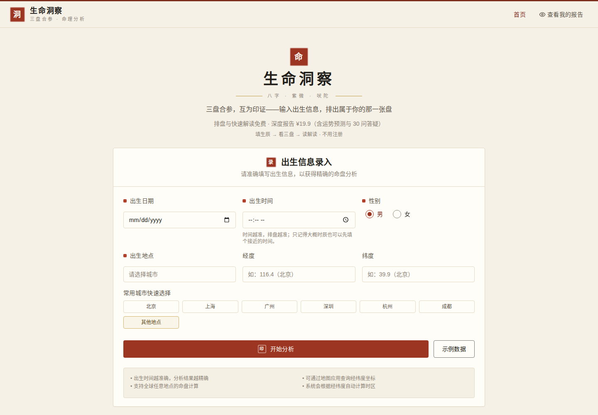
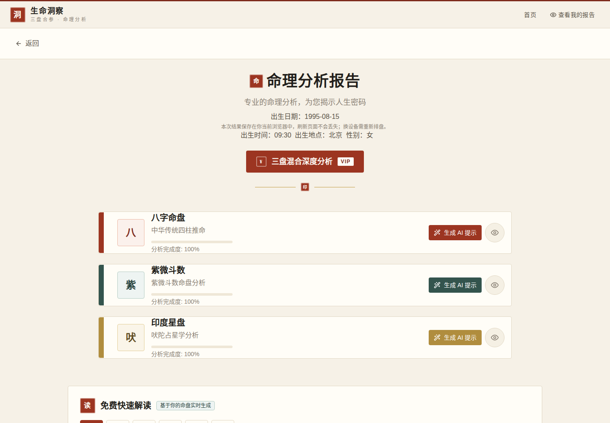

# LifeInsight · 生命洞察

> **输入一次生辰，八字、紫微斗数、印度星盘三张盘同时排完，互相印证。**
> Enter one birth chart — BaZi, Zi Wei Dou Shu, and Vedic astrology calculated together, cross-checked against each other.

[](LICENSE)
[](backend/requirements.txt)
[](backend/app/main.py)
[](frontend/package.json)
[](backend/tests/)

单看一个体系总有盲区：八字看五行气势与大运，紫微看十二宫结构与四化，印度盘看行星力量与分盘。
LifeInsight 把三套盘放在同一张结果里算完，再由**本地规则引擎**（零 token、不用等大模型、不用花 API 钱）
给出可复现的解读；需要更深的追问时，再接大模型做融合报告。





*截图为本地部署实拍，示例盘 1995-08-15 09:30 北京·女，数据由本仓库引擎实时算出。*

---

## ✨ 功能

- **三盘合参** —— 八字（sxtwl）、紫微斗数（py-iztro）、印度星盘（flatlib）一次算完，
  输出四柱五行、十二宫四化、行星宫位等完整结构化数据
- **真太阳时与全球时区** —— 按出生地经纬度自动查时区并做真太阳时校正，海外出生也能排
- **本地规则引擎，零 token** —— 不配任何 API Key 也能出解读：八字大运推排与喜用方向、
  神煞全量检测、紫微四化落宫与飞化、吠陀 Vimshottari 大运与星宿、行星尊贵度与宫主飞入，
  全部结论由盘面数据推导、可复现（`POST /api/analysis/local-analysis`）
- **紫微格局严格判定** —— 移植 Renhuai123/ziwei-doushu `patterns.ts` 的判定口径：
  必须条件 / 加分条件 / 破格条件三层校验，**四星全格与三星会严格区分**，不把“像”算成“是”
- **神煞全量检测** —— 29 项查表神煞 + 空亡 / 魁罡 / 三奇，查表数据来自 chinese-fortune，
  附《三命通会》《渊海子平》出处考据
- **AI 深度报告（可选）** —— 接入大模型（OpenAI 兼容接口，可切换 DeepSeek）做性格 / 事业 /
  感情 / 健康 / 综合融合解读；只有这一步需要 Key，排盘与本地解读永远免费
- **Prompt 管理后台 + 兑换码系统** —— 解读 prompt 模板可后台编辑、版本化；兑换码生成与核销自带

## 🚀 快速开始

环境要求：Python 3.12、Node.js 16+（实测 Node 24 可用）。

```bash
git clone https://github.com/VinceLing0529/lifeinsight-web.git
cd lifeinsight-web

# 一键启动（首次自动建 venv、装依赖、构建前端）
bash run-local.sh
# 前端 http://localhost:3000  ·  后端 http://localhost:8000/health
```

手动启动（与 `run-local.sh` 等价）：

```bash
# 后端
python3 -m venv backend/.venv
backend/.venv/bin/pip install -r backend/requirements.txt
# flatlib 锁定的 pyswisseph 2.08 在 Python 3.12 下 ABI 不兼容，必须升级
backend/.venv/bin/pip install -U "pyswisseph>=2.10"
cd backend/app && ../.venv/bin/python -m uvicorn main:app --host 127.0.0.1 --port 8000

# 前端（另开终端）
cd frontend && npm install && npm start   # 开发模式 :3000
# 或：REACT_APP_API_URL=http://localhost:8000 npm run build，用任意静态服务器托管 build/
```

> **在线演示**：目前没有公网演示站（正在筹备上线），按上面三步本地跑起来就是完整演示。
> 排盘与本地解读不需要任何 Key；只有 AI 深度报告需要在后端 `.env` 里配 Key
> （OpenAI 兼容接口，例如 `DEEPSEEK_API_KEY`），不配 Key 时其余功能照常可用。

## 🔌 API（核心）

```http
GET  /health                                  # {"status": "healthy"}

POST /api/charts/calculate                   # 三盘全量排盘
Content-Type: application/json
{"birth_date": "1995-08-15", "birth_time": "09:30",
 "longitude": 116.4, "latitude": 39.9, "gender": 0, "location_name": "北京"}

POST /api/analysis/local-analysis            # 零 token 本地规则解读
{"chart_data": {…排盘返回的 data…}, "analysis_type": "comprehensive"}
```

## 🧪 测试

```bash
cd backend && .venv/bin/python -m pytest tests/ -q   # 49 项：格局判定 / 神煞 / 本地解读 + 端点
```

判定口径以 [Renhuai123/ziwei-doushu](https://github.com/Renhuai123/ziwei-doushu) 的
`patterns.ts` 原版为准；测试用例含真实盘、合成盘与空 / 残缺 / 脏数据。

## 🗂️ 项目结构

```
lifeinsight-web/
├── backend/
│   ├── app/
│   │   ├── main.py              # FastAPI 入口
│   │   ├── api/                 # charts / analysis / ai_report / 管理后台路由
│   │   ├── core/                # ziwei_patterns.py（格局）· shensha.py（神煞）· ratelimit.py（防刷）
│   │   └── triple_chart_parser.py
│   └── tests/                   # pytest：格局 / 神煞 / 本地解读
├── frontend/                    # React 18：首页录入 → 结果页（三盘卡片 + 快速解读）
├── docs/                        # 截图
└── run-local.sh                 # 本地一键启动
```

## 🗺️ 路线图

- [x] 三盘合参排盘 + 真太阳时
- [x] 本地规则引擎（零 token 解读）
- [x] 紫微格局严格判定 + 神煞全量检测
- [x] 自动化测试套件（49 项）
- [ ] 公网演示站上线
- [ ] PDF 报告导出
- [ ] 用户账户与历史记录

## 🙏 致谢

- [Renhuai123/ziwei-doushu](https://github.com/Renhuai123/ziwei-doushu)（MIT）——
  紫微格局判定逻辑移植自其 `lib/ziwei/patterns.ts`（严格化版本），中文说明为本项目自撰
- [ShousenZHANG/chinese-fortune](https://github.com/ShousenZHANG/chinese-fortune)（MIT）——
  神煞查表数据来自其 `assets/shensha.json`，检测逻辑与释义为本项目自撰
- [sxtwl](https://github.com/jjonline/calendar.js)（八字历法）、
  [py-iztro](https://github.com/SivaBaranJiva/py-iztro)（紫微排盘）、
  [flatlib](https://github.com/flatlib/flatlib)（吠陀星盘）—— 三盘计算引擎

## 📝 许可证与免责

本项目采用 MIT 许可证，见 [LICENSE](LICENSE)。
命理分析仅供参考与娱乐，不应作为人生重大决策的唯一依据。

问题反馈请走 [Issues](https://github.com/VinceLing0529/lifeinsight-web/issues)；
觉得有用请点 ⭐ Star —— 你的 star 是这个项目继续往前做的最大动力。

---

## English

**LifeInsight** calculates BaZi, Zi Wei Dou Shu, and Vedic charts from a single birth input,
cross-checking three systems against each other instead of trusting any one alone.

- **Three charts, one run** — BaZi (sxtwl), Zi Wei (py-iztro), Vedic (flatlib), with true solar
  time correction from birth longitude/latitude.
- **Zero-token local engine** — no API key needed for a real reading: BaZi dayun cycles and
  favorable elements, full shensha detection, Zi Wei Si Hua placements and flying stars,
  Vedic Vimshottari dasha and nakshatra, planetary dignities and house-lord placements.
  Every conclusion is derived from the chart data and reproducible
  (`POST /api/analysis/local-analysis`).
- **Strict Zi Wei pattern detection** — ported from Renhuai123/ziwei-doushu's `patterns.ts`:
  required / bonus / breaking conditions checked in three layers, so a three-star
  convergence is never reported as a full four-star pattern.
- **Optional AI deep report** — OpenAI-compatible (DeepSeek supported); this is the only
  step that needs a key. Charts and local readings always work without one.
- **Quick start** — `bash run-local.sh`, then open http://localhost:3000
  (backend health at http://localhost:8000/health). No public demo yet — local run *is*
  the full demo.
- **Tests** — `cd backend && .venv/bin/python -m pytest tests/ -q` (49 tests, all passing).
- **License** — MIT. Readings are for reference and entertainment only.
